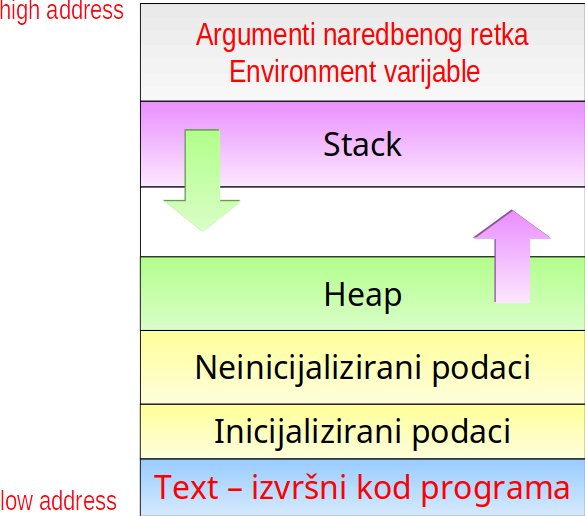
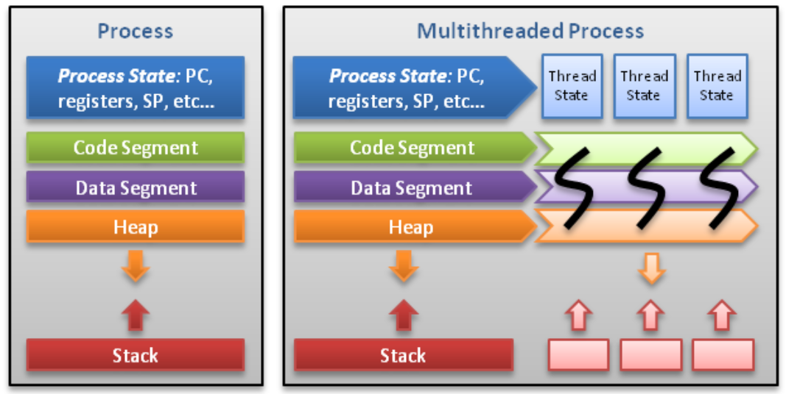
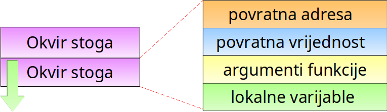
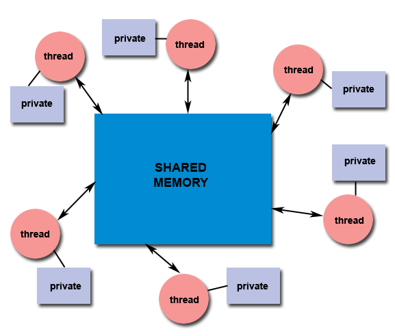
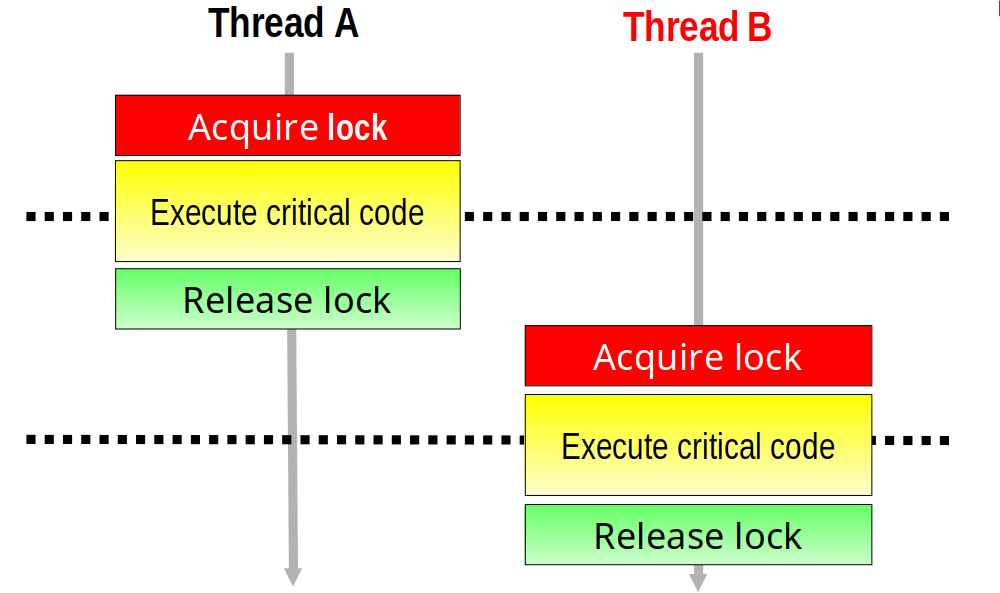
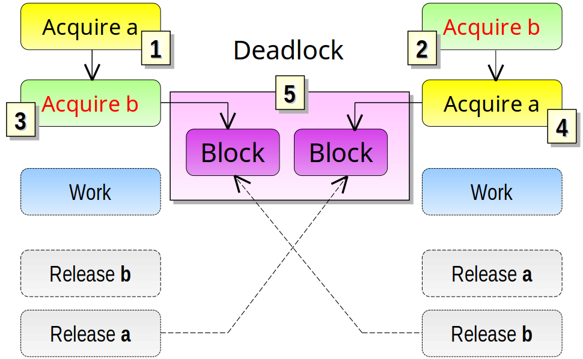
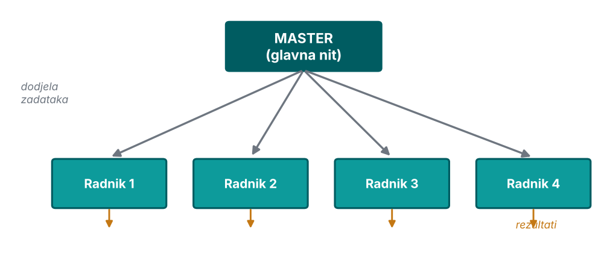
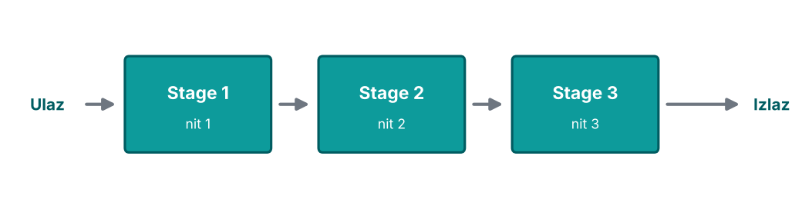
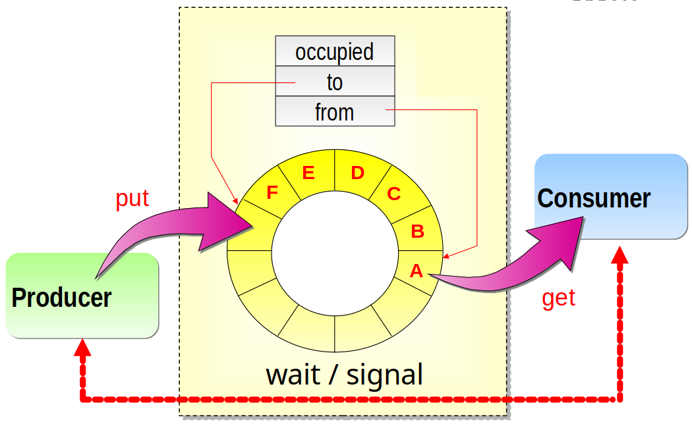

# Procesi

## Što je proces?

- **Proces:** izvršna jedinica u kojoj se izvodi program (skup instrukcija zapisanih u izvršnoj datoteci)
- Izvršava se u **zasebnom memorijskom prostoru**
- Računalni program postaje proces kada se **učita iz pohrane (datoteke) u memoriju** računala i počne izvršavati

## Memorijska slika procesa

:::::: columns
::: {.column width="54%"}
\small

- opisuje kako je proces organiziran u memoriji
- sadrži vitalne informacije o procesu:
    - **Program Counter (PC)** --- adresa sljedeće naredbe
    - **registri**
    - informacije o otvorenim datotekama
    - signali i maske signala…
:::
::: {.column width="44%"}
{width=92%}
:::
::::::

## Memorijska slika procesa --- izolacija

\begin{center}
\setlength{\fboxsep}{8pt}
\colorbox{fesbSvijetla!15}{\parbox{0.86\linewidth}{\centering
Procesi međusobno \textbf{ne mogu} dijeliti informacije putem zajedničkih varijabli ili pokazivača na istu adresu u memoriji.}}
\end{center}

- svaki proces vidi **samo svoj** adresni prostor
- dijeljenje podataka zahtijeva poseban mehanizam (IPC)

## Svojstva procesa

- zaseban sistemski poziv za stvaranje svakog procesa
- **izolirana memorija** --- ne dijele podatke
- komunikacija (dijeljenje podataka) preko **IPC** (*Inter-Process Communication*) --- zahtjevno i sporo
- upravljanje procesom zahtijeva više sistemskih poziva
- svaki proces ima svoj **stog** (stack) i **hrpu** (heap)
- proces se može izvršavati na jednom ili više procesora

# Niti (Threads)

## Što su niti?

- izvršna jedinica kao **dio procesa** (*lightweight process*)
- proces može imati **više niti**
- niti unutar istog procesa izvršavaju se istovremeno (ili u dijeljenom vremenu)
- neovisno upravljanje svakom niti
- ubrzavanje procesa korištenjem **zadaćnog paralelizma**
- niti se izvršavaju u **istom memorijskom prostoru**

## Svojstva niti

- jedan sistemski poziv može stvoriti više niti
- niti unutar istog procesa **dijele memorijski prostor**
- dijele **tekst segment** (kod), **globalne varijable** i **hrpu** (heap)
- svaka nit ima **svoj stog**
- upravljanje nitima zahtijeva minimum sistemskih poziva
- nema potrebe za posebnim komunikacijskim mehanizmom (zajedničke varijable --- ne troše se resursi ni vrijeme na komunikaciju)

## Procesi vs. niti

| | **Proces** | **Nit** |
|:--|:--|:--|
| memorija | zaseban prostor | dijele prostor |
| komunikacija | teška (IPC) | brza (zajedničke varijable) |
| sistemski pozivi | više | manje |
| svojstvo | izolacija --- sigurnije | dijeljenje --- brže |
| kreiranje | teže | lakše |

## Procesi vs. niti

{height=62%}

\begin{center}
\small Svaka nit ima svoj stog, ostalo dijele!
\end{center}

## Funkcijski pozivi i stog

- kod svakog poziva funkcije kreira se **novi okvir** na stogu → zato svaka nit mora imati **svoj** stog!
- svaki okvir sadrži: povratnu adresu, rezultat funkcije, parametre, lokalne varijable

{width=78%}

## Funkcijski pozivi i stog

- svaka nit izvršava **svoj tok** programa → poziva svoje funkcije
- svaka nit treba **svoj stog** → da zna gdje se vratiti i koje su joj lokalne varijable
- **lokalne** varijable su **privatne** za svaku nit (na njenom stogu)
- **globalne** varijable su **zajedničke** (nisu na stogu!)

{width=72%}

## Višenitni pristup dijeljenoj memoriji

:::::: columns
::: {.column width="52%"}
{width=100%}
:::
::: {.column width="46%"}
\small

**Dijeljeno (shared):**

- globalne varijable
- dinamički alocirani podaci (heap)
- izvršni kod programa

**Privatno (private):**

- lokalne varijable (stog)
- parametri funkcija
- povratne adrese
:::
::::::

## Primjer: dijeljeni brojač

```c
int count = 0;                 // SHARED (globalna)
void* worker(void* arg) {
    for (int i = 0; i < 1000; i++)  // i: PRIVATE (stog)
        count++;               // svi mijenjaju ISTU varijablu!
    return NULL;
}
```

- ako **3 niti** izvršavaju ovu funkciju --- koliko će biti `count`?
- očekivano 3000… ali **ne nužno!** (vidjet ćemo zašto)

# Problemi sinkronizacije

## Thread safety (sigurnost niti)

- sposobnost programa da istovremeno izvršava više niti **bez narušavanja konzistentnosti** zajedničke memorije (*race condition*)

\begin{center}
\setlength{\fboxsep}{8pt}
\colorbox{fesbSvijetla!15}{\parbox{0.8\linewidth}{\centering Problem: sve niti mijenjaju \textbf{istu} memorijsku lokaciju!}}
\end{center}

## Thread safety --- rutine

- **Thread-safe rutina:**
    - koristi sinkronizacijske mehanizme (mutex, lock)
    - sprječava da više niti istovremeno mijenja zajedničke podatke
    - rezultati predvidljivi i ispravni
- **Rutina koja NIJE thread-safe:**
    - nema zaštitu zajedničkih podataka
    - nepredvidljivi rezultati, moguće rušenje
- **Preporuka:** ako niste 100 % sigurni da je biblioteka thread-safe → pretpostavite da **nije**; serijalizirajte pozive, ili implementirajte eksplicitni mehanizam sinkronizacije

## Race condition

- više niti pristupa istoj globalnoj varijabli
- **krajnji rezultat ne smije ovisiti o redoslijedu** pristupa (koji ne možemo predvidjeti)
- primjer: `count++` nad dijeljenom varijablom iz više niti

## Je li `count++` atomska operacija?

**Strojni kod (assembler):**

```asm
mov eax, [count]   ; 1. učitaj iz memorije u registar
inc eax            ; 2. uvećaj registar
mov [count], eax   ; 3. spremi natrag u memoriju
```

- nit može biti **prekinuta između bilo koja dva koraka**
- očekivanje: 2 niti × 10000 = **20000**
- stvarnost: 15234, 18921, 19654… **različito svaki put!**

## Race condition --- scenarij 1

Nema preklapanja --- `count = 5` na početku:

```asm
Thread 1                 Thread 2
mov eax,[count]  (5)
inc eax          (6)
mov [count],eax  (6)
                         mov eax,[count]  (6)
                         inc eax          (7)
                         mov [count],eax  (7)
```

- Thread 2 počinje **nakon** što je Thread 1 završio → **count = 7**

## Race condition --- scenarij 2

```asm
Thread 1                 Thread 2
mov eax,[count]  (5)
inc eax          (6)
                         mov eax,[count]  (5)  ← čita staro!
mov [count],eax  (6)
                         inc eax          (6)
                         mov [count],eax  (6)
```

- Thread 2 pročitao `count` **prije** nego ga je Thread 1 spremio → **count = 6** (umjesto 7)

## Race condition --- tri niti

Tri niti rade `count++`, početno `count = 5`, očekivano **8**.

```asm
Thread 1            Thread 2            Thread 3
mov eax,[count]
                    mov eax,[count]
                                        mov eax,[count]
inc eax
                    inc eax
                                        inc eax
mov [count],eax
                    mov [count],eax
                                        mov [count],eax
```

- sve tri pročitale istu vrijednost → **count = 6** (umjesto 8!)

## Race condition --- tri niti

Drugo preplitanje istih triju niti (`count = 5`, očekivano **8**):

```asm
Thread 1            Thread 2            Thread 3
mov eax,[count]
                    mov eax,[count]
inc eax
                    inc eax
mov [count],eax
                    mov [count],eax
                                        mov eax,[count]
                                        inc eax
                                        mov [count],eax
```

- T1 i T2 se preklope (izgube jedan `++`), T3 radi poslije → **count = 7** (umjesto 8!)
- različita preplitanja → **različiti pogrešni rezultati**, nepredvidljivo

## Race condition --- zaključak

- **ne možemo predvidjeti** koji će scenarij nastupiti!
    - ovisi o raspoređivaču OS-a (*scheduler*)
    - ovisi o trenutnom opterećenju procesora
- **nedeterministički** rezultat --- svako pokretanje može biti drugačije

\begin{center}
\setlength{\fboxsep}{8pt}
\colorbox{fesbSvijetla!15}{\parbox{0.6\linewidth}{\centering Zato nam treba \textbf{sinkronizacija}!}}
\end{center}

## Atomske operacije

- **atomska operacija** = operacija koja se izvršava kao **nedjeljiva cjelina**
- karakteristike:
    - ili se izvrše **svi** koraci, ili **nijedan**
    - ne može se prekinuti „na pola puta"
- ne postoji mogućnost:
    - da operacija bude prekinuta tijekom izvođenja
    - da se tijekom izvođenja neovisno promijeni stanje varijabli koje koristi

## Atomske operacije --- primjer

```c
int x = y;      // atomska (na većini arhitektura): jedan upis
count++;        // NIJE atomska: učitaj → uvećaj → spremi
```

- problem: `count++` nad običnim `int` **nije** atomska → dva rješenja:

:::::: columns
::: {.column width="50%"}
\small

**Atomski tip** (C11 `<stdatomic.h>`):

```c
atomic_int count = 0;
count++;   // sada ATOMSKI
```

- kompajler generira atomsku instrukciju (npr. `lock xadd`)
- brzo; za **jednu** varijablu/operaciju
:::
::: {.column width="48%"}
\small

**Mutex** (*mutual exclusion*):

```c
pthread_mutex_lock(&m);
count++;
pthread_mutex_unlock(&m);
```

- štiti **blok koda** (više naredbi)
- općenitije, ali sporije
:::
::::::

## Mutex --- uzajamno isključivanje

- **Mutual exclusion (mutex):** mehanizmom zaključavanja (lock) programer realizira **protokol pristupa** dijeljenim podacima
- protokol se mora primijeniti u **svim** nitima koje pristupaju podatku
    - prekrši li ga jedna nit (greška) → protokol je neuspješan
- nit koja želi pristup mora postaviti **zahtjev za zaključavanje** i čekati na ključ

## Mutex --- protokol rada

- nit postavlja **zahtjev za zaključavanje** (lock) i čeka na ključ
- kad dobije ključ → ulazi u **kritičnu sekciju** (pristupa podacima)
- druge niti koje žele isti podatak → **moraju čekati**
- nakon obrade → nit **otključava** mutex (unlock); čekajuća nit sada može dobiti ključ

\footnotesize Mutex držati **samo dok je nužno** --- inače nepotrebno čekanje i usporavanje.

## Kritična sekcija

:::::: columns
::: {.column width="50%"}
- **kritična sekcija** = dio koda koji pristupa dijeljenim podacima
- **samo jedna nit** odjednom smije biti u kritičnoj sekciji
:::
::: {.column width="48%"}
{width=100%}
:::
::::::

## Primjer --- mutex

```c
pthread_mutex_t mutex;
int count = 0;

void* thread_function(void* arg) {
    for (int i = 0; i < 10000; i++) {
        pthread_mutex_lock(&mutex);    // zaključaj
        count++;                       // KRITIČNA SEKCIJA
        pthread_mutex_unlock(&mutex);  // otključaj
    }
    return NULL;
}
// main: pthread_mutex_init(&mutex, NULL); ... pthread_mutex_destroy(&mutex);
// count = 20000 (točno!)
```

\footnotesize Primjer u repou: `P05-POSIX_niti/mutex.c`, `utrka.c`

## Deadlock (potpuni zastoj)

{height=58%}

\begin{center}
\setlength{\fboxsep}{7pt}
\colorbox{fesbNaglasak!15}{\parbox{0.72\linewidth}{\centering \textbf{DEADLOCK!} --- obje niti čekaju jedna drugu, zauvijek}}
\end{center}

## Primjer --- deadlock

```c
void* thread_A(void* arg) {
    pthread_mutex_lock(&lock_a);   // 1: dobio lock_a
    sleep(1);
    pthread_mutex_lock(&lock_b);   // 3: čeka lock_b (DEADLOCK!)
    ...
}
void* thread_B(void* arg) {
    pthread_mutex_lock(&lock_b);   // 2: dobio lock_b
    sleep(1);
    pthread_mutex_lock(&lock_a);   // 4: čeka lock_a (DEADLOCK!)
    ...
}
```

\footnotesize Primjer u repou: `P04-Procesi_i_niti/deadlock.c`

## Deadlock --- rješenje

\begin{center}
\setlength{\fboxsep}{8pt}
\colorbox{fesbSvijetla!15}{\parbox{0.8\linewidth}{\centering Rješenje: sve niti zaključavaju brave u \textbf{istom redoslijedu}}}
\end{center}

```c
// obje niti: prvo lock_a, pa lock_b
pthread_mutex_lock(&lock_a);
pthread_mutex_lock(&lock_b);
...
pthread_mutex_unlock(&lock_b);
pthread_mutex_unlock(&lock_a);
```

\footnotesize Primjer u repou: `P04-Procesi_i_niti/deadlock_ispravak.c`

# Dizajn višenitnih programa

## Problemi dizajna paralelnih algoritama

- **particioniranje** problema --- kako podijeliti posao
- **balansiranje opterećenja** --- sve niti podjednako zauzete
- ovisnost podataka, komunikacija i uzajamno isključivanje
- **race condition** --- sinkronizacija pristupa
- ulazno/izlazni tokovi
- složenost algoritma
- **trud / benefit** --- isplati li se paralelizacija?

## Dobri kandidati za višenitnost

- postojanje **zadaćnog ili podatkovnog paralelizma** u problemu
- potencijalno **čekanje** na spore U/I operacije
- neravnomjerno korištenje CPU ciklusa u različitim dijelovima programa
- potrebna **responsivnost** na asinkrone događaje
- prioritetni prekidi --- neki poslovi važniji od drugih

## Modeli višenitnih programa

Najčešće paradigme paralelnog programiranja:

- **Master / slave** (upravitelj / radnik)
- **Workcrew / SPMD** (radna ekipa)
- **Pipeline** (cjevovod)
- **Producer / consumer** (proizvođač / potrošač)

## 1. Master / slave (upravitelj / radnik)

:::::: columns
::: {.column width="50%"}
\small

- **centralizirano** upravljanje: glavna nit (*master*) dodjeljuje poslove radnim nitima (*slaves*) i **akumulira** rezultate
- isti račun se izvršava više puta, s **različitim** ulaznim podacima
- radnici rade različitim brzinama; po završetku preuzimaju novi zadatak
:::
::: {.column width="48%"}
{width=100%}
:::
::::::

## Master / slave --- kod

```c
void* master(void* arg) {
    for (int i = 0; i < NUM_WORKERS; i++)         // stvori radnike
        pthread_create(&workers[i], NULL, slave, &tasks[i]);
    for (int i = 0; i < NUM_WORKERS; i++)         // čekaj rezultate
        pthread_join(workers[i], &results[i]);
    aggregate_results(results);                   // akumuliraj
}
void* slave(void* task) {
    return process(task);                         // obradi zadatak
}
```

\footnotesize Primjer u repou: `P04-Procesi_i_niti/poslovodja_radnik.c`

## Master / slave --- prednosti i nedostaci

- **Prednosti:**
    - jednostavno upravljanje (centralizirana kontrola)
    - lako balansiranje opterećenja; broj radnika može varirati
    - master može dodjeljivati poslove **dinamički**
- **Nedostaci:**
    - master može postati **usko grlo** (*bottleneck*)
    - ako master padne --- cijeli sustav pada
    - overhead komunikacije s masterom

## 2. Workcrew / SPMD (radna ekipa)

- jedna nit stvara sve ostale **na početku**; svaki čvor preuzima **svoj dio** problema
- **statička raspodjela** posla (unaprijed poznat i dobro definiran skup podataka)
- sve niti izvršavaju se **istovremeno bez lidera** (SPMD --- *Single Program, Multiple Data*)
- prikladno za: matrične operacije, pretraživanja, generatore podataka…

## Workcrew --- množenje matrica

```c
void* worker(void* arg) {
    int id = *(int*)arg;
    int start = id * (N / NUM_THREADS);
    int end   = (id + 1) * (N / NUM_THREADS);
    for (int i = start; i < end; i++)        // svaka nit svoje redove
        for (int j = 0; j < N; j++) {
            C[i][j] = 0;
            for (int k = 0; k < N; k++)
                C[i][j] += A[i][k] * B[k][j];
        }
    return NULL;
}
```

\footnotesize Primjer u repou: `P04-Procesi_i_niti/mnozenje_matrica.c`

## 3. Pipeline (cjevovod)

- dugačak slijed ulaznih podataka; svaki se obrađuje nizom **podoperacija** (filteri)
- svaka nit = jedna **faza** cjevovoda (*stage*)
- svaka faza nezavisno obrađuje trenutni podatak
- **važno:** ravnomjerno balansiranje --- najsporija faza blokira cijeli cjevovod

## Pipeline --- tok podataka

{width=94%}

```text
T1: Stage1[A]
T2: Stage1[B]  Stage2[A]
T3: Stage1[C]  Stage2[B]  Stage3[A]
T4: Stage1[D]  Stage2[C]  Stage3[B]   ← svi stage-ovi aktivni
```

\footnotesize Primjer u repou: `P04-Procesi_i_niti/pipeline.c`

## Pipeline --- primjena, prednosti, nedostaci

:::::: columns
::: {.column width="50%"}
\small

**Primjena:**

- video stream (read→decode→process→encode→write)
- obrada slika (load→filter→enhance→compress→save)
- mrežni paketi (receive→parse→process→send)
:::
::: {.column width="48%"}
\small

**Prednosti:** visoka propusnost, prirodna dekompozicija, lako dodavanje faza

**Nedostaci:** najsporija faza usporava sve, overhead prosljeđivanja, latencija prvog podatka
:::
::::::

## 4. Producer / consumer (proizvođač / potrošač)

:::::: columns
::: {.column width="50%"}
\small

- dvije vrste niti: **producer** i **consumer**
- dijele zajednički **buffer** (red) fiksne veličine
- producer **dodaje** podatke, consumer ih **uzima**
- **asinhrona** komunikacija
:::
::: {.column width="48%"}
{width=100%}
:::
::::::

## Producer / consumer --- protokol

- **Producer:**
    - ako je buffer **pun** → čeka (sleep) ili odbacuje podatak
    - dodaje podatak i šalje **signal** consumeru
- **Consumer:**
    - ako je buffer **prazan** → čeka (sleep)
    - uzima podatak i šalje **signal** produceru

\footnotesize Primjer u repou: `P04-Procesi_i_niti/proizvodjac_potrosac.c`

## Producer / consumer --- prednosti, nedostaci, primjena

- **Prednosti:** *decoupling* (nezavisni), rade različitim brzinama, buffer apsorbira nagle navale
- **Nedostaci:** složena sinkronizacija, mogući deadlock, ograničena veličina buffera
- **Primjena:** event-driven sustavi (UI), logging, mrežni serveri, multimedia streaming, print spooler

# Sažetak

## Ključne poruke

- **Procesi** su izolirani (zaseban adresni prostor, IPC); **niti** dijele memoriju procesa, a svaka ima svoj stog
- dijeljena memorija donosi **race condition** → `count++` nije atomski → treba **sinkronizacija** (mutex, atomske operacije)
- pogrešno zaključavanje vodi u **deadlock** → rješenje je **isti redoslijed** zaključavanja
- višenitni programi grade se obrascima: **master/slave, workcrew/SPMD, pipeline, producer/consumer**

## Što slijedi

- **Predavanje 5** --- POSIX niti (pthreads): stvaranje, sinkronizacija, uvjetne varijable u praksi
- primjeri koda uz ovo predavanje: `P04-Procesi_i_niti/` i `P05-POSIX_niti/`
