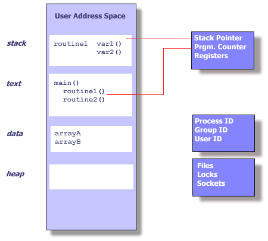
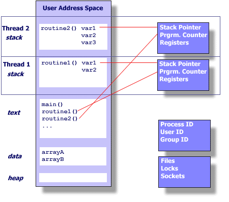

# Uvod

## Što je nit (thread)?

- **Definicija:** neovisni tok instrukcija koji može biti raspoređen od strane OS-a
- **Za programera:** procedura koja se izvršava neovisno od glavnog programa
    - višenitni program = više procedura koje se izvršavaju istovremeno
- **Kako funkcionira:**
    - niti postoje **unutar procesa**
    - niti koriste resurse procesa
    - niti se mogu raspoređivati neovisno

## UNIX proces vs niti

:::::: columns
::: {.column width="50%"}
\small

**UNIX proces sadrži:**

- Process ID, User ID, Group ID
- environment varijable
- programske instrukcije (kod)
- CPU stanje (registri)
- memorija (stack, heap)
- file deskriptori, signali
- shared libraries, IPC resursi
:::
::: {.column width="48%"}
{width=100%}
:::
::::::

\begin{center}
\small Niti \textbf{dijele većinu} ovih resursa!
\end{center}

## Niti unutar procesa

:::::: columns
::: {.column width="48%"}
{width=100%}
:::
::: {.column width="50%"}
\small

**Privatno (svaka nit IMA):**

- stack pointer --- vlastiti stog
- registri --- vlastito CPU stanje
- prioritet (scheduling)
- pending/blocked signali

**Dijeljeno (shared):**

- text segment (kod)
- data segment (globalne varijable)
- heap, datoteke, brave, socketi
:::
::::::

## Zašto su niti „lightweight"?

- nit u UNIX okruženju:
    - postoji unutar procesa i koristi njegove resurse
    - ima vlastiti neovisni tok izvršavanja
    - duplicira **samo esencijalne** resurse potrebne za scheduling
    - dijeli resurse procesa s drugim nitima
- posljedice dijeljenja:
    - promjene od jedne niti **vide sve** druge niti
    - dva pokazivača s istom vrijednošću pokazuju na iste podatke
    - čitanje/pisanje na istu lokaciju → **zahtijeva eksplicitnu sinkronizaciju!**

## Registri: procesor i proces/nit

- **CPU registri** --- stvarni hardverski registri; postoji **samo jedan skup** po jezgri
    - u svakom trenutku drže stanje niti koja se izvršava (PC, stack pointer, međurezultati)
- **„Registri" procesa/niti** --- **spremljena kopija** tog stanja u memoriji (TCB/PCB)
    - OS ih spremi/vrati pri prebacivanju → svaka nit pamti dokle je stigla

\begin{center}
\setlength{\fboxsep}{7pt}
\colorbox{fesbSvijetla!15}{\parbox{0.88\linewidth}{\centering Spremljeni registri \textbf{odgovaraju} procesorskima po broju i namjeni --- pa su \textbf{ovisni o arhitekturi}}}
\end{center}

- x86-64: `rax…rsp`, `rip`, `rflags`, SSE/AVX · ARM64: `x0–x30`, `sp`, `pc`, NEON · RISC-V: `x0–x31`
- isti **izvorni** program na dvije arhitekture → različit strojni kod i registri, isto logičko ponašanje (prenosivost daje jezik/standard, ne registri)

## Context switching --- što se prebacuje?

:::::: columns
::: {.column width="50%"}
\small

**Niti (isti proces):**

- CPU registri + PC
- stack pointer (vlastiti stog)
- adresni prostor se **ne mijenja** (dijele ga)
:::
::: {.column width="48%"}
\small

**Procesi (dodatno):**

- adresni prostor (`CR3` / tablica stranica)
- **TLB flush**, cache „ohladi"
- file deskriptori, signali
:::
::::::

\begin{center}
\setlength{\fboxsep}{7pt}
\colorbox{fesbSvijetla!15}{\parbox{0.9\linewidth}{\centering Prebacivanje niti \textbf{ne dira memorijski podsustav} (TLB/cache ostaju valjani) → bitno \textbf{jeftinije} od prebacivanja procesa}}
\end{center}

## Zašto su niti brže od procesa?

- **kreiranje** --- manje overhead-a, ne kopira se cijeli adresni prostor
- **komunikacija** --- dijele memoriju, ne treba IPC mehanizam
- **context switch** --- brži nego između procesa

\begin{center}
\setlength{\fboxsep}{8pt}
\colorbox{fesbNaglasak!15}{\parbox{0.82\linewidth}{\centering \textbf{brže $\neq$ lakše} --- s nitima dobivate performanse, ali i složenost sinkronizacije}}
\end{center}

# POSIX Threads (Pthreads)

## Što su POSIX niti?

- **Zašto standard?** prije: svaki proizvođač vlastita implementacija → kod nije prenosiv
- **POSIX Threads (pthreads):** prenosiv API za programiranje s nitima
- dostupan na: Linux, Unix, macOS, BSD

```c
#include <pthread.h>
```

```text
gcc -pthread program.c -o program
```

## Osnovni tipovi podataka

- **`pthread_t`** --- *thread identifier* (ID niti)
- **`pthread_mutex_t`** --- mutex lock (brava za sinkronizaciju)
- **`pthread_cond_t`** --- *condition variable* (uvjetna varijabla)

\vspace{1ex}

Ostali (naprednije, spominjemo usput):

- **`pthread_attr_t`** --- atributi niti

## `pthread_create()`

```c
int pthread_create(
    pthread_t *thread,               // [OUT] ID stvorene niti
    const pthread_attr_t *attr,      // [IN]  atributi (NULL = default)
    void *(*start_routine)(void *),  // [IN]  funkcija koju nit izvršava
    void *arg                        // [IN]  argument za funkciju
);
```

- **povratna vrijednost:** `0` (uspjeh), `EAGAIN` (nema resursa), `EINVAL` (loši atributi)

## `pthread_create()`

- kreira novu nit unutar procesa
- nova nit izvršava `start_routine(arg)`
- Thread ID sprema u `*thread`
- ako je `attr == NULL` → default atributi

\begin{center}
\setlength{\fboxsep}{8pt}
\colorbox{fesbSvijetla!15}{\parbox{0.88\linewidth}{\centering Nova nit je \textbf{ravnopravna} s postojećim nitima --- uključujući nit u kojoj se izvršava \texttt{main()}. \\ \textbf{Nema „glavne" niti}: sve niti dijele isti status.}}
\end{center}

## Anatomija thread funkcije

```c
void* thread_function(void* arg) {
    // 1. tip MORA biti: void* f(void*)
    // 2. prima JEDAN argument (void* — generic pointer)
    // 3. vraća void* (ili NULL)

    printf("Thread is running\n");

    return NULL;   // ili pthread_exit(NULL);
}
```

# Kreiranje niti i argumenti

## Primjer 1 --- jednostavna nit

```c
#include <pthread.h>
#include <stdio.h>

void* pozdrav(void* arg) {
    printf("Pozdrav iz niti!\n");
    return NULL;
}

int main() {
    pthread_t tid;
    pthread_create(&tid, NULL, pozdrav, NULL);
    pthread_join(tid, NULL);     // čekaj da nit završi
    return 0;
}
```

\footnotesize Primjer u repou: `P05-POSIX_niti/pozdrav_nit.c`

## Primjer 2 --- slanje `int` argumenta

```c
void* worker(void* arg) {
    int value = *(int*)arg;      // cast void* → int*
    printf("Primljeno: %d\n", value);
    return NULL;
}

int main() {
    pthread_t tid;
    int value = 42;
    pthread_create(&tid, NULL, worker, &value);  // šaljemo ADRESU
    pthread_join(tid, NULL);
    return 0;
}
```

\footnotesize Ključno: šaljemo **adresu** (`&value`) kao `void*`, u funkciji castamo u `int*`. · `P05/argument_int.c`

## Primjer 3 --- slanje strukture

```c
typedef struct { int id; char ime[32]; double ocjena; } Student;

void* obradi(void* arg) {
    Student* r = (Student*)arg;
    printf("%d: %s, %.2f\n", r->id, r->ime, r->ocjena);
    return NULL;
}

int main() {
    pthread_t tid;
    Student r = {1, "Ana", 4.5};
    pthread_create(&tid, NULL, obradi, &r);
    pthread_join(tid, NULL);
    return 0;
}
```

\footnotesize Primjer u repou: `P05-POSIX_niti/argument_struktura.c`

## Česta greška --- pokazivač na lokalnu varijablu

```c
void* worker(void* arg) {
    int value = *(int*)arg;
    printf("Thread %d\n", value);
    return NULL;
}
...
for (int i = 0; i < 5; i++) {
    // SVE niti dobivaju ISTU adresu &i — čitaju i kad se već promijenio!
    pthread_create(&tid[i], NULL, worker, &i);
}
```

- izlaz: `Thread 3, 5, 5, 4, 5…` --- **nedeterministički!**
- sve niti dijele **istu** varijablu `i`, koja se u petlji mijenja

\footnotesize Primjer u repou: `P05-POSIX_niti/greska_petlja.c`

## Ispravno --- rješenje 1 (polje)

```c
int args[5];
for (int i = 0; i < 5; i++) {
    args[i] = i;                 // svaka nit svoja lokacija
    pthread_create(&tid[i], NULL, worker, &args[i]);
}
```

- izlaz: `Thread 0, 1, 2, 3, 4` --- **deterministički!**
- svaka nit dobiva **vlastitu** adresu koja se ne mijenja

\footnotesize Primjer u repou: `P05-POSIX_niti/ispravak_polje.c`

## Ispravno --- rješenje 2 (malloc)

```c
for (int i = 0; i < 5; i++) {
    int* p = malloc(sizeof(int));   // vlastita memorija na heapu
    *p = i;
    pthread_create(&tid[i], NULL, worker, p);
}
// u niti: int v = *(int*)arg;  free(arg);
```

\footnotesize Primjer u repou: `P05-POSIX_niti/rezultat_malloc.c`

## Kada koje rješenje?

| | **Polje (array)** | **malloc (po niti)** |
|:--|:--|:--|
| broj niti | **poznat** unaprijed | dinamičan / nepoznat |
| alokacija | --- (na stogu) | N poziva |
| oslobađanje | automatsko (po kraju) | N × ručno `free()` |
| kada | fiksan, mali N | niti žive različito dugo |

## Ispravno --- rješenje 3 (dinamičko polje)

```c
int* args = malloc(N * sizeof(int));   // JEDAN malloc za cijelo polje
for (int i = 0; i < N; i++) {
    args[i] = i;                       // svaka nit svoj slot
    pthread_create(&tid[i], NULL, worker, &args[i]);
}
...
for (int i = 0; i < N; i++) pthread_join(tid[i], NULL);
free(args);                            // JEDAN free na kraju
```

- kompromis: dinamično (`N` nije poznat u prevođenju), ali **jedna** alokacija i **jedan** `free`

# Izlazak iz niti i povratna vrijednost

## `pthread_exit()` --- završetak niti

```c
void pthread_exit(void *retval);
```

- **završava** nit koja ga poziva (može se pozvati **bilo gdje** u niti)
- vrijednost `retval` postaje dostupna preko `pthread_join` (u `*retval`)
- ostale niti nastavljaju raditi

## Završetak niti --- `return` iz funkcije

- `return ptr;` iz funkcije s kojom je nit započela ima **isti efekt** kao `pthread_exit(ptr)`:
    - nit završava, a `ptr` postaje njezina povratna vrijednost

```c
void* worker(void* arg) {
    ...
    return rezultat;          // ≡ pthread_exit(rezultat);
}
```

\begin{center}
\setlength{\fboxsep}{7pt}
\colorbox{fesbNaglasak!15}{\parbox{0.9\linewidth}{\centering \textbf{Oprez:} \texttt{return} iz \texttt{main()} prekida \textbf{cijeli proces} --- sve niti! \\ Da ostale niti nastave, u \texttt{main()} pozvati \texttt{pthread\_exit(NULL)} umjesto \texttt{return}.}}
\end{center}

## `pthread_join()` --- prototip

```c
int pthread_join(
    pthread_t thread,    // [IN]  ID niti na koju čekamo
    void **retval        // [OUT] pokazivač na povratnu vrijednost
);
```

- što radi:
    - **blokira** pozivajuću nit dok ciljna nit ne završi
    - **sprema** povratnu vrijednost niti (tipa `void*`, tj. adresu rezultata) u `*retval`
    - **oslobađa** resurse niti

## Primjer 1 --- jednostavno čekanje

```c
void* slow_worker(void* arg) {
    printf("Starting work...\n");
    sleep(3);
    printf("Work completed!\n");
    return NULL;
}

int main() {
    pthread_t tid;
    pthread_create(&tid, NULL, slow_worker, NULL);
    printf("Main: waiting...\n");
    pthread_join(tid, NULL);     // blokira ~3 s
    printf("Main: thread finished\n");
    return 0;
}
```

## Primjer 2 --- vraćanje `int` rezultata

```c
void* calculate_sum(void* arg) {
    int n = *(int*)arg;                  // vrijednost iz argumenta
    int* result = malloc(sizeof(int));   // MORA malloc!
    *result = 0;
    for (int i = 1; i <= n; i++) *result += i;
    return (void*)result;                // vraćamo pokazivač
}

int main() {
    pthread_t tid;  int* sum;  int n = 100;
    pthread_create(&tid, NULL, calculate_sum, &n);
    pthread_join(tid, (void**)&sum);     // primamo pokazivač
    printf("Sum: %d\n", *sum);
    free(sum);                           // ne zaboraviti!
    return 0;
}
```

## Česta greška --- pokazivač na stog

```c
void* bad_function(void* arg) {
    int result = 42;          // lokalna varijabla na stogu!
    return (void*)&result;    // stog niti se briše nakon returna
}
```

\begin{center}
\setlength{\fboxsep}{8pt}
\colorbox{fesbNaglasak!15}{\parbox{0.82\linewidth}{\centering Stog niti se briše nakon završetka! \\ Rezultat mora biti na \textbf{heapu} (\texttt{malloc}) ili u dijeljenoj varijabli.}}
\end{center}

\footnotesize Primjeri u repou: `P05-POSIX_niti/rezultat_malloc.c`, `suma_niti.c`

# Sinkronizacija --- mutex

## Zašto trebamo mutex? (podsjetnik)

Dvije niti izvršavaju `count++` (početno `count = 5`):

```asm
Thread 1              Thread 2
mov eax,[count] (5)
                      mov eax,[count] (5)   ← čita staro
inc eax         (6)
                      inc eax         (6)
mov [count],eax (6)
                      mov [count],eax (6)
```

- obje niti pročitale istu vrijednost → **count = 6** (umjesto 7)
- rješenje: **mutex** (*mutual exclusion*) --- samo jedna nit odjednom u kritičnoj sekciji

\footnotesize (race condition detaljno obrađen u Predavanju 4)

## Inicijalizacija mutexa

```c
#include <pthread.h>

// Način 1: statička inicijalizacija
pthread_mutex_t mutex = PTHREAD_MUTEX_INITIALIZER;

// Način 2: dinamička inicijalizacija
pthread_mutex_t mutex;
pthread_mutex_init(&mutex, NULL);   // NULL = default atributi

// Na kraju programa:
pthread_mutex_destroy(&mutex);
```

## Osnovne operacije s mutexom

```c
// zaključavanje (čeka dok ne dobije lock)
int pthread_mutex_lock(pthread_mutex_t *mutex);

// otključavanje
int pthread_mutex_unlock(pthread_mutex_t *mutex);

// pokušaj zaključavanja (NE čeka!)
int pthread_mutex_trylock(pthread_mutex_t *mutex);
// vraća: 0 (uspjeh) ili EBUSY (već zaključan)
```

- sve vraćaju: `0` = uspjeh, `error code` = greška

## Primjer bez mutexa (race condition)

```c
int counter = 0;                 // globalna varijabla
void* bad_increment(void* arg) {
    for (int i = 0; i < 100000; i++)
        counter++;               // RACE CONDITION!
    return NULL;
}
// main: 10 niti × 100000
// očekivano: 1000000
// stvarno:   847392, 923018, 991234… (nasumično!)
```

\footnotesize Primjer u repou: `P05-POSIX_niti/utrka.c`

## Kritična sekcija (mutex)

```c
pthread_mutex_t mutex = PTHREAD_MUTEX_INITIALIZER;
int shared_counter = 0;

void* increment_thread(void* arg) {
    for (int i = 0; i < 1000000; i++) {
        pthread_mutex_lock(&mutex);
        shared_counter++;              // KRITIČNA SEKCIJA
        pthread_mutex_unlock(&mutex);
    }
    return NULL;
}
// 2 niti → Counter: uvijek 2000000!
```

\footnotesize Primjer u repou: `P05-POSIX_niti/mutex.c`

## Pravila korištenja mutexa

:::::: columns
::: {.column width="50%"}
\small

**Dobro:**

- lock čim ulazimo u kritičnu sekciju
- unlock čim izlazimo
- držati lock **što kraće**
- uvijek unlock isti mutex koji smo lockali
- bez blokirajućih poziva unutar locka
:::
::: {.column width="48%"}
\small

**Loše:**

- zaboraviti unlock → deadlock
- lockati isti mutex dvaput → deadlock
- držati lock predugo → performanse
- `sleep()` ili U/I unutar kritične sekcije
:::
::::::

## Optimizacija --- lokalno računanje

```c
// SPORO: lock za svaki korak (milijun lockova!)
for (int i = 0; i < 1000000; i++) {
    pthread_mutex_lock(&mutex);
    global_sum += i;
    pthread_mutex_unlock(&mutex);
}

// BRZO: lokalno zbroji, mutex SAMO za završnu akumulaciju
long local = 0;
for (int i = 0; i < 1000000; i++) local += i;   // bez mutexa
pthread_mutex_lock(&mutex);
global_sum += local;                             // jednom po niti
pthread_mutex_unlock(&mutex);
```

\footnotesize Primjer u repou: `P05-POSIX_niti/suma_niti.c`

## Alternativa za jednu varijablu: `atomic_int`

```c
#include <stdatomic.h>
atomic_int count = 0;
count++;                 // ATOMSKI, bez mutexa
```

- za **jednu** varijablu/operaciju: brže i jednostavnije od mutexa
- mutex ostaje nužan za **blok** naredbi (više varijabli, invarijante)

# Uvjetne varijable

## Zašto uvjetne varijable?

- mutex rješava **isključivi pristup**, ali ne i **čekanje na uvjet**
- problem: nit treba čekati da se nešto dogodi (npr. „buffer nije prazan")
- loše rješenje --- **busy-waiting** (vrtnja u petlji troši CPU):

```c
while (buffer_prazan)      // nit stalno provjerava → troši CPU!
    ;                      // (uz lock/unlock — još gore)
```

- **uvjetna varijabla** (*condition variable*) omogućuje niti da **zaspi** dok je uvjet neispunjen i da je druga nit **probudi**

## Uvjetna varijabla --- operacije

```c
pthread_cond_t cond = PTHREAD_COND_INITIALIZER;

// nit ČEKA: atomarno otključa mutex i zaspi; na buđenje opet zaključa
int pthread_cond_wait(pthread_cond_t *cond, pthread_mutex_t *mutex);

// BUĐENJE jedne niti koja čeka
int pthread_cond_signal(pthread_cond_t *cond);

// buđenje SVIH niti koje čekaju
int pthread_cond_broadcast(pthread_cond_t *cond);
```

- **uvijek** se koristi zajedno s mutexom
- `pthread_cond_wait` atomarno: otključa mutex → uspava nit → (na buđenje) ponovno zaključa

## Obrazac korištenja

```c
// NIT KOJA ČEKA                 // NIT KOJA SIGNALIZIRA
pthread_mutex_lock(&m);          pthread_mutex_lock(&m);
while (!uvjet)                   uvjet = true;
    pthread_cond_wait(&cond,&m); pthread_cond_signal(&cond);
// uvjet je sada ispunjen        pthread_mutex_unlock(&m);
...
pthread_mutex_unlock(&m);
```

\begin{center}
\setlength{\fboxsep}{7pt}
\colorbox{fesbNaglasak!15}{\parbox{0.86\linewidth}{\centering Uvjet se provjerava u \texttt{while} petlji, ne \texttt{if} --- zbog \textbf{lažnih buđenja} (\textit{spurious wakeups}) i više potrošača}}
\end{center}

## Primjer --- proizvođač / potrošač

```c
pthread_mutex_t m = PTHREAD_MUTEX_INITIALIZER;
pthread_cond_t  ima_podataka = PTHREAD_COND_INITIALIZER;

void* potrosac(void* arg) {
    pthread_mutex_lock(&m);
    while (broj == 0)                        // buffer prazan?
        pthread_cond_wait(&ima_podataka, &m);// zaspi dok ne stigne
    uzmi_podatak();                          // kritična sekcija
    pthread_mutex_unlock(&m);
    return NULL;
}
void* proizvodac(void* arg) {
    pthread_mutex_lock(&m);
    dodaj_podatak(); broj++;
    pthread_cond_signal(&ima_podataka);      // probudi potrošača
    pthread_mutex_unlock(&m);
    return NULL;
}
```

\footnotesize Primjer u repou: `P04-Procesi_i_niti/proizvodjac_potrosac.c`

# Sažetak

## Ključne poruke

- **pthreads** je prenosiv API: `pthread_create`, `pthread_join`, `pthread_exit` (`#include <pthread.h>`, `gcc -pthread`)
- argumenti se šalju kao `void*` → **svaka nit vlastita memorija** (polje ili `malloc`), nikad pokazivač na promjenjivu lokalnu varijablu
- povratne vrijednosti na **heapu**, ne na stogu niti
- **mutex** štiti kritičnu sekciju; optimizacija: lokalno računaj, zaključaj samo akumulaciju
- **uvjetne varijable** rješavaju čekanje na uvjet bez busy-waitinga (uvijek uz mutex, uvjet u `while`)

## Što slijedi

- **Predavanje 6** --- OpenMP: dijeljena memorija na višoj razini apstrakcije (direktive umjesto ručnog upravljanja nitima)
- primjeri koda uz ovo predavanje: `P05-POSIX_niti/` i `P04-Procesi_i_niti/`
